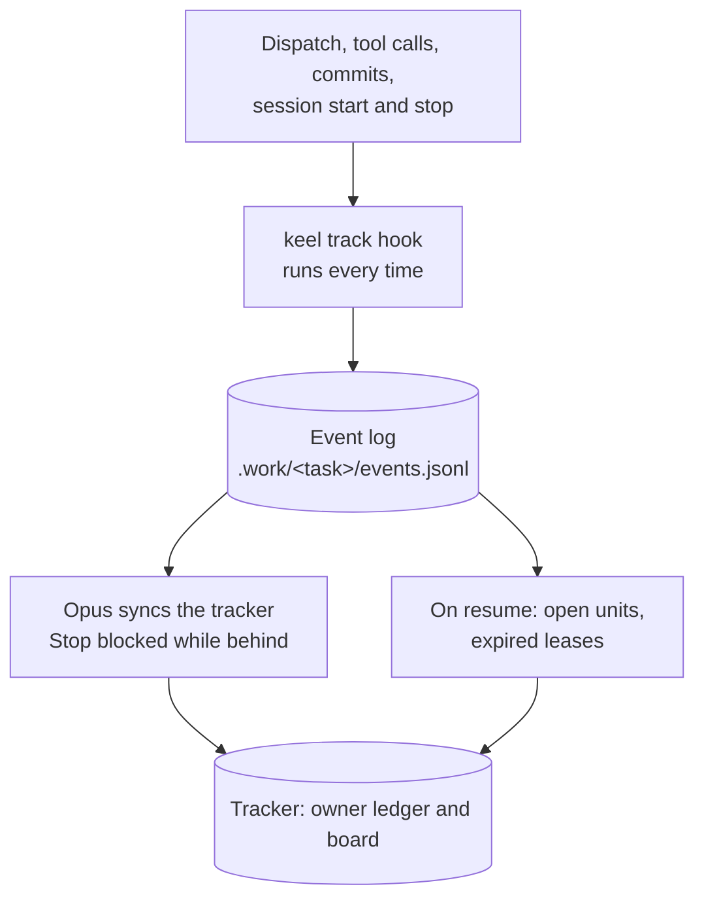
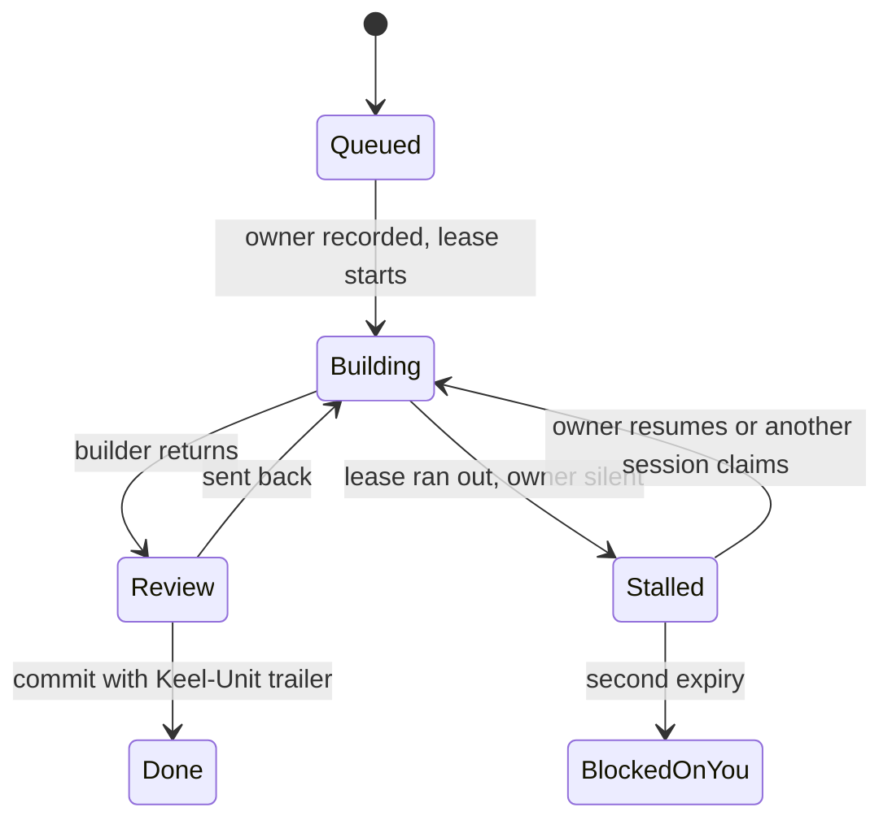

# keel

An engineering workflow for building products with Claude Code.

keel decides how much process a task needs, plans just enough, builds in small checked steps, debugs from evidence, and proves the result where users meet it before shipping. It's written for strong models: short instructions, plus a few hooks that enforce the rules that matter most.

Every task runs with three roles: **Sonnet 5.5 builds**, **Fable 5.2 counsels** (reviews every plan and approves or improves it), and **Opus 5.5 is responsible** (owns the plan, reviews every unit, proves and ships). M and L tasks get a live tracker page pinned to your claude.ai sidebar.

```bash
/plugin marketplace add ravipetlur/keel
/plugin install keel@keel

/keel:keel <what you want, and how you'll know it's done>
```

| Size | Flow |
|---|---|
| **S** small and obvious | plan → build → prove → ship |
| **M** a feature or fix | frame → shape → build → prove → ship → learn, with a tracker |
| **L** cross-cutting or risky | M, plus counsel on the brief and an adversarial review |
| **Debug** cause unknown | debug, then the flow for its size |

## How keel tracks agent work

A tracker is only worth looking at while it's current. When updating it is a duty the agent has to remember, updates land late: when you ask, or when a chunk of work is done. keel takes that duty off the agents.

1. **Events come from things that happen anyway.** A hook records every builder dispatch, every return, every commit, every phase change, and every session start, stop and failure in `.work/<task>/events.jsonl`, as it happens.
2. **Silence is the signal.** A session that hits its usage limit can't report that it stopped. Every assignment is a lease. When a lease runs out with no sign of life, the card turns to "no signal" on its own.
3. **The owner is written down before work starts.** A builder can't be dispatched until its owner and lease are in the tracker, the one place every session can see.



**Push by default, pull when the owner is gone.** Opus hands out units. Before each dispatch it records the owner, and the hook refuses the dispatch until it has seen that write. If Opus itself stops, its leases run out. Another session (or the same one after the limit resets) claims each stalled unit with a version-pinned tracker write, so only one claim can win. A unit that stalls twice comes to you instead.



The full design (event types, the fields the tracker stores, the claim rules, what happens when things go wrong, and how to turn it down) is in [How keel tracks agent work](docs/tracking.md).

## Docs

- [Quickstart](docs/quickstart.md). Install, first task, and how to steer it.
- [How it works](docs/how-it-works.md). Sizes, roles, phases, the tracker, what it asks about, and the files it keeps.
- [Hooks](docs/hooks.md). What gets blocked, flagged, or required.
- [How keel tracks agent work](docs/tracking.md). Events, leases, push and pull assignment, and keeping the tracker in step.
- [Debugging](docs/debugging.md). The eight-step protocol and its variants.
- [Customize](docs/customize.md). Where things live and how to change them.
- [Principles](skills/keel/PRINCIPLES.md). The ten rules underneath it all.

## Develop

```bash
tests/hooks.test.sh          # hook decisions against sample payloads
claude plugin validate .     # manifest and layout
```

## Credits

keel combines ideas from [pstack](https://github.com/cursor/plugins/tree/main/pstack) by Lauren Tan and [gstack](https://github.com/garrytan/gstack) by Garry Tan, both MIT licensed. The text and code here are keel's own.

MIT licensed.
