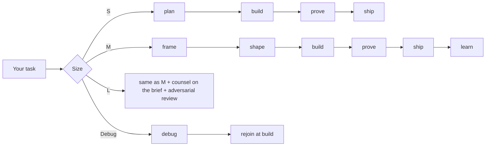

# How it works

keel does two things: it picks how much process a task deserves, then it runs that process with a few hard checks along the way.

## Roles

Every task, at every size, splits the work across three models:

| Role | Model | Job |
|---|---|---|
| Responsible | Opus 5.5 | Runs the session. Sizes, frames, shapes, debugs. Dispatches each unit, reviews the diff, re-runs its check, commits it. Proves and ships. Accountable for the result. |
| Counsel | Fable 5.2 | Reviews every plan before any code is written, and answers **Approved** or **Improve** with concrete changes. Up to two rounds, then open points go to you. |
| Builder | Sonnet 5.5 | Implements one unit at a time from the approved plan and reports the real output of its check. |

Opus doesn't write the production code, and Sonnet doesn't decide what to build. If your session isn't on Opus, keel says so and asks you to switch.

## Sizes

| Size | Typical task | Extra steps |
|---|---|---|
| **S** | Clear bug, small change, one file | A few-line plan that counsel approves, then build, prove, ship |
| **M** | Feature or fix across a few modules, one PR | Brief and shape first, lessons at the end |
| **L** | New subsystem, migration, risky production change | Counsel also reviews the brief, and a second model tries to break the code |
| **Debug** | Broken, flaky or slow, cause unknown | The debug protocol runs first |

When in doubt, keel picks the smaller size and moves up if the work grows.

## Phases

**Frame** (M, L). A brief of 15 lines or fewer: who has the problem, a done check that can fail, the belief the work bets on, what's out of scope, and the smallest version worth shipping. It asks you at most three questions, about product or taste only, and continues with stated defaults while you think. On L, counsel reviews the brief before shaping.

**Shape** (M, L). About one screen: the data model and interfaces, an ordered list of units that each end in a check, the top three risks, and open design choices. If a choice can be settled by trying it, keel builds a quick throwaway prototype instead of asking you. Counsel then approves or improves the plan; nothing is built until it says **Approved**.

**Build** (all). One unit at a time, each built by a Sonnet subagent, then reviewed, re-checked and committed by Opus before the next. A failing test first when it's cheap. Builders run in parallel only on units with no files in common.

**Debug** (when needed). See [Debugging](debugging.md).

**Prove** (all). The repo's checks, then the behavior shown where users meet it: the UI, CLI, API or job. Then a read of the full diff as the next maintainer would see it. L tasks also get an adversarial review. All output goes to `evidence/`.

**Ship** (all). Small ordered commits and a PR with why, evidence, gates weakened, and decisions you can override. It watches CI until it's green. It never deploys unless you say so.

**Learn** (M, L). One-line lessons. A lesson that comes up twice becomes a lint, test, hook or script instead of another note.

## Tracker

Each M and L task opens a tracker: a claude.ai page pinned to your sidebar, backed by its own small database. It shows who does what, plan against actual for each phase, every unit with who built it and how many review rounds it took, what keel needs from you, and recent activity. Planned dates are fixed when counsel approves the plan; only the expected dates move after that. keel updates it at every state change, so it never falls behind the work.

If the session has no Artifact tool (for example, Claude Code not signed in to claude.ai), keel writes `tracker: none (<reason>)` and carries on. Ask for one on an S task by saying "track this".

## Autonomy

| It just does it | It asks first | It always stops |
|---|---|---|
| Reversible code changes, branches, local runs, prototypes, PRs, CI re-runs | Product scope, UX and taste, new runtime dependencies, anything you put out of scope | Deploys, force-push to shared branches, migrations on real data, deleting data, messages to customers, weakening a test or check |

## Files it keeps

| File | What's in it |
|---|---|
| `.work/current` | Slug of the open task. The hooks check for this file, so they stay quiet when no task is open. |
| `task.md` | Size, current phase, tracker link, and the plan for S tasks |
| `brief.md`, `shape.md` | Frame and shape output, with each counsel round |
| `debug.md` | Repro, hypotheses, and what ruled each one out |
| `decisions.tsv` | Choices made without asking, and how to reverse each |
| `gates.tsv` | Skips and suppressions added, each needing a reason |
| `evidence/` | Proof that the change works |
| `.work/learnings.md` | Lessons across all tasks |

Next: [Hooks](hooks.md).
