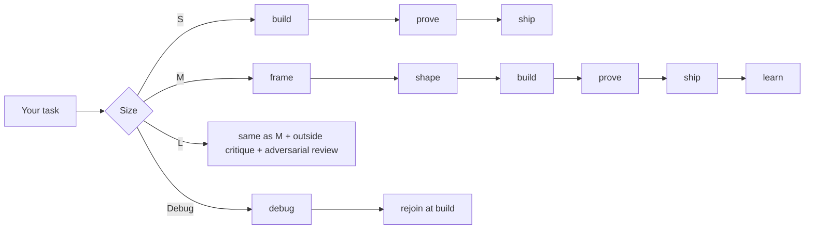

# How it works

keel does two things: it picks how much process a task deserves, then it runs that process with a few hard checks along the way.

## Sizes

| Size | Typical task | Extra steps |
|---|---|---|
| **S** | Clear bug, small change, one file | None. Build, prove, ship. |
| **M** | Feature or fix across a few modules, one PR | Brief and shape first, lessons at the end |
| **L** | New subsystem, migration, risky production change | A second model critiques the shape and tries to break the code |
| **Debug** | Broken, flaky or slow, cause unknown | The debug protocol runs first |

When in doubt, keel picks the smaller size and moves up if the work grows.

## Phases

**Frame** (M, L). A brief of 15 lines or fewer: who has the problem, a done check that can fail, the belief the work bets on, what's out of scope, and the smallest version worth shipping. It asks you at most three questions, about product or taste only, and continues with stated defaults while you think.

**Shape** (M, L). About one screen: the data model and interfaces, an ordered list of units that each end in a check, the top three risks, and open design choices. If a choice can be settled by trying it, keel builds a quick throwaway prototype instead of asking you.

**Build** (all). One unit at a time, checked and committed before the next. A failing test first when it's cheap. Subagents only for work that doesn't overlap.

**Debug** (when needed). See [Debugging](debugging.md).

**Prove** (all). The repo's checks, then the behavior shown where users meet it: the UI, CLI, API or job. Then a read of the full diff as the next maintainer would see it. L tasks also get an adversarial review. All output goes to `evidence/`.

**Ship** (all). Small ordered commits and a PR with why, evidence, gates weakened, and decisions you can override. It watches CI until it's green. It never deploys unless you say so.

**Learn** (M, L). One-line lessons. A lesson that comes up twice becomes a lint, test, hook or script instead of another note.

## Autonomy

| It just does it | It asks first | It always stops |
|---|---|---|
| Reversible code changes, branches, local runs, prototypes, PRs, CI re-runs | Product scope, UX and taste, new runtime dependencies, anything you put out of scope | Deploys, force-push to shared branches, migrations on real data, deleting data, messages to customers, weakening a test or check |

## Files it keeps

| File | What's in it |
|---|---|
| `.work/current` | Slug of the open task. The hooks check for this file, so they stay quiet when no task is open. |
| `task.md` | Size and current phase |
| `brief.md`, `shape.md` | Frame and shape output |
| `debug.md` | Repro, hypotheses, and what ruled each one out |
| `decisions.tsv` | Choices made without asking, and how to reverse each |
| `gates.tsv` | Skips and suppressions added, each needing a reason |
| `evidence/` | Proof that the change works |
| `.work/learnings.md` | Lessons across all tasks |

Next: [Hooks](hooks.md).
