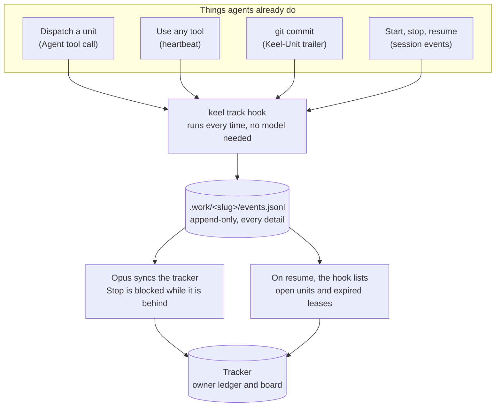
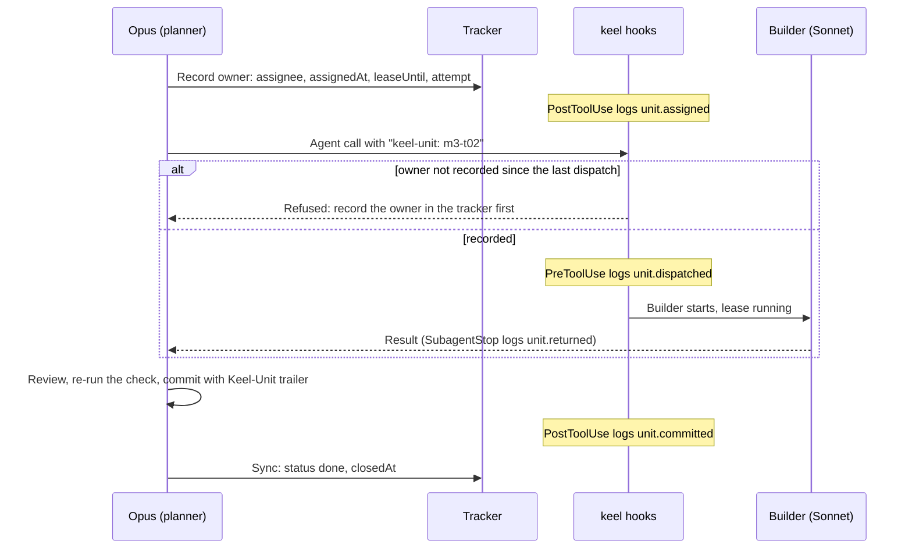
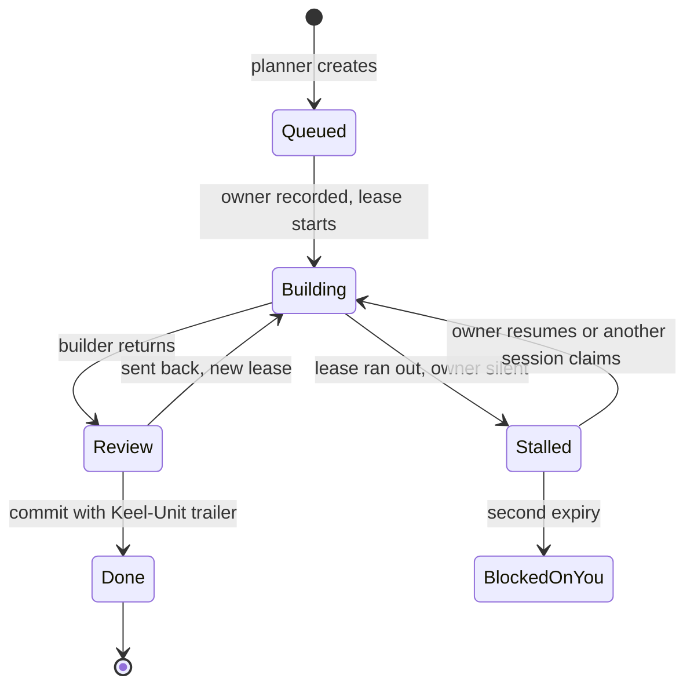

# How keel tracks agent work

The tracker is only useful while it's current. When updating it is something an agent has to remember, the update gets put off until a natural pause: you ask, or a chunk of work finishes. That's why progress used to land late.

keel takes the reporting duty off the agents. Hooks record what happens as it happens, an append-only event log keeps that record, and the tracker is brought up to date from the log. The model still writes the tracker, because only the model can, but a hook will not let it stop while the tracker is behind.

## Three rules

1. **Events come from things that happen anyway.** Dispatching a builder, running a tool, committing, starting and stopping a session. Hooks run every time, so none of this depends on an agent remembering to report.
2. **A stopped agent can't say it stopped, so silence is the signal.** An agent that hits its hourly or weekly limit sends nothing. Every assignment is a lease with an end time. When a lease runs out and the owner has gone quiet, the task is stalled, and the page shows it without anyone reporting it.
3. **Who owns a task is written down before the work starts.** The owner goes into the tracker, the one place every session can see, before a builder is allowed to begin. A hook enforces the order.

## The flow



Everything above the tracker is deterministic. The one model step is the sync, and the Stop hook makes sure it happens before Opus finishes a turn.

## Where each event comes from

All of these are written by `hooks/track.sh`. It is quiet when no keel task is open.

| Event | Hook | When |
|---|---|---|
| `unit.assigned` | `PostToolUse` on the tracker write | Opus writes a new owner to a task in the tracker: an `assignee` with an `assignedAt` the hook hasn't seen for that unit |
| `unit.dispatched` | `PreToolUse` on the Agent tool | A builder is started with `keel-unit: <id>` in its brief |
| `unit.returned` | `SubagentStop` | The builder finishes. The unit comes from the `keel-unit:` line in the builder's brief (the first line of its own transcript), from its agent id once the dispatch result has named it, or from the `keel-unit:` line the builder ends its report with |
| `unit.committed` | `PostToolUse` on `git commit` | The new commit carries a `Keel-Unit: <id>` trailer |
| `phase.changed` | `PostToolUse` on `task.md` | The `phase:` line changes |
| `counsel.approved` | `PostToolUse` on `shape.md` or `task.md` | A `Counsel verdict: approved` line appears |
| `tracker.write` | `PostToolUse` on the tracker write | Any write to this task's tracker |
| `heartbeat` | `PostToolUse` on any tool | At most once a minute per agent; a builder's heartbeat names its unit |
| `session.started`, `turn.ended`, `session.compacting`, `session.ended` | `SessionStart`, `Stop`, `PreCompact`, `SessionEnd` | The session's own lifecycle |
| `session.failed` | `StopFailure` | A turn ended on an API error, such as a usage limit |
| `dispatch.refused` | `PreToolUse` on the Agent tool | The dispatch gate said no |

Some events are logged but don't change the board: dispatches and returns that carry no unit (`agent.dispatched`, `agent.returned`), commits with no trailer (`commit`), and tracker writes that were refused (`tracker.write_failed`).

The unit id is the tracker's task document id, such as `m3-t02`. It travels in two places the model writes anyway: a `keel-unit: m3-t02` line in the builder brief, and a `Keel-Unit: m3-t02` trailer on the commit.

## The event log

One JSON object per line in `.work/<slug>/events.jsonl`, appended and never rewritten:

```json
{"at":"2026-11-27T10:02:11Z","type":"unit.dispatched","session":"3f9a2c1b","agent":"main","unit":"m3-t02","data":{"model":"sonnet"}}
```

The log is the full record of the task: it can be replayed, and the tracker can be rebuilt from it. It lives in the checkout, so it is local to one machine and one worktree. The tracker is what other sessions see.

Some events change what the board should show: `unit.dispatched`, `unit.returned`, `unit.committed`, `phase.changed` and `counsel.approved`. These have to reach the tracker. Heartbeats and session events stay in the log.

## Assignment: push by default

Opus hands out units, as before. What's new is that the owner is recorded first.



Each dispatch, including a send-back for fixes, needs a fresh owner write with a new `assignedAt`, so every lease starts with the tracker knowing about it. Extending a lease writes only `leaseUntil` and doesn't count as a new owner.

If a builder dies without a result while Opus is fine, that is still push: Opus records the owner again and re-dispatches.

## Assignment: pull as the fallback

Pull is for when the one handing out work is gone: Opus hit a usage limit, or its session closed. Another session, or the same one after it resumes, looks for stalled tasks and claims them.

A session may claim a task only when all of these hold:

- its status is `building`, `fixing` or `review`,
- its `leaseUntil` has passed,
- its owner has gone quiet: the tracker has not been synced for 30 minutes (`status/current.updatedAt`), or this checkout's log shows the owner's session ended,
- its `attempt` is below 2.

The claim is one tracker write: the task's new `assignee`, `assignedBy: "pull"`, `leaseUntil` and `attempt + 1`, plus an `assignments` row, pinned with `if_version` to the version just read. If two sessions claim at once, one write succeeds and the other is refused because the version moved; the loser re-reads, sees the new owner, and backs off. A claim is an owner write like any other, so it goes through the same dispatch gate.

A task whose lease runs out a second time is not claimed again. It goes to you instead (`status: waiting`, `need: blocked`), because a unit that stalls twice usually has a cause an agent can't fix by retrying.

Two builders on the same unit means conflicting commits, which is far worse than taking over late. That is why the takeover rules are conservative.

## Leases and staleness



- **The lease is set at dispatch.** It is the unit's expected duration plus 30 minutes of grace, or 90 minutes when there's no estimate. Opus extends it for running units each time it syncs.
- **During a long build, only the builder is active.** Its heartbeats reach the local log but not the tracker, so the lease is generous.
- **Stalled is worked out, not stored.** The page compares `leaseUntil` with the current time every minute and shows a dashed "no signal" card when it has passed. It also warns when the tracker hasn't been synced for 30 minutes while units are running. Nobody has to write "stalled".
- **Blocked on you is stored**, as the existing `waiting` status with `need: "blocked"`.

## Keeping the tracker in step

The hook can't write the tracker. Tracker writes are a model tool, not something a shell script can call. So it makes the sync impossible to skip:

- **At the end of every turn,** the Stop hook counts board-changing events logged since the last tracker write. If there are any, it blocks the stop and names them, so Opus writes them before finishing. As with keel's other Stop checks, a second stop is always let through, so it can't trap the agent.
- **At session start, resume and after compaction,** the hook tells Opus its session id (for `assignee.session`), lists units that are open in this checkout's log with their lease state, and says how many events the tracker hasn't seen yet.

If the whole Opus session stops before syncing, the page keeps the last state it was given and then shows "no signal" as leases run out. The log catches the tracker up when a session resumes.

## What the tracker stores

On each task (`tasks/<id>`), alongside the existing fields:

| Field | Meaning |
|---|---|
| `assignee` | `{session, agent, model}`: the session id from the SessionStart note, the role, and the model, e.g. `{session: "3f9a2c1b", agent: "builder", model: "Sonnet 5.5"}` |
| `assignedBy` | `push` or `pull` |
| `assignedAt`, `leaseUntil` | UTC times; `leaseUntil` is when the owner's lease runs out |
| `attempt` | 1 for the first assignment, plus 1 for each re-assignment after an expired lease |

One row per assignment in `assignments/<id>-a<N>`, for the history: `unit`, `attempt`, `to`, `how` (`push` / `pull`), `startedAt`, `endedAt`, `outcome` (`done` / `released` / `expired` / `reclaimed`).

`status/current.session` names the session that last synced the tracker, so a claimer can tell whether the owner is the one that went quiet.

## When things go wrong

| What happens | What you see | What recovers it |
|---|---|---|
| A builder dies, Opus is fine | Card stays in Build until Opus notices the missing result | Opus records the owner again and re-dispatches (push) |
| Opus hits a usage limit | Cards keep their last state, then turn to "no signal" as leases run out; the header warns the tracker hasn't been synced | The same session after the limit resets, or another session, claims the stalled units (pull) |
| Two sessions claim the same unit | One claim succeeds | The `if_version` pin refuses the second write |
| A unit stalls twice | Red card, "blocked on you" | You decide what happens next |
| The tracker write isn't visible to hooks | Nothing is blocked | The gate and the Stop check only arm after the hook has seen at least one tracker write in the task; until then events are logged and nothing is refused |
| No tracker (`tracker: none`) | No page | Events are still logged locally; nothing is gated |

## Turning it down

| Setting | Effect |
|---|---|
| `KEEL_TRACK=off` | `track.sh` does nothing |
| `KEEL_TRACK_GATE=off` | Events are still logged, but no dispatch is refused and Stop is never blocked for an unsynced tracker |
| `KEEL_BEAT_SECS=300` | Seconds between heartbeats per agent (default 60) |

Set them in the `env` block of your Claude Code settings.

## Limits

- The sync to the tracker is still a model step, so there is a gap between an event and the page. The Stop check bounds it to one turn.
- Heartbeats from a running builder reach only the local log, never the tracker directly. Leases are sized for that.
- The local log is per checkout. Pull across machines and cloud sessions relies on the tracker alone, which is why the owner is always written there first.
